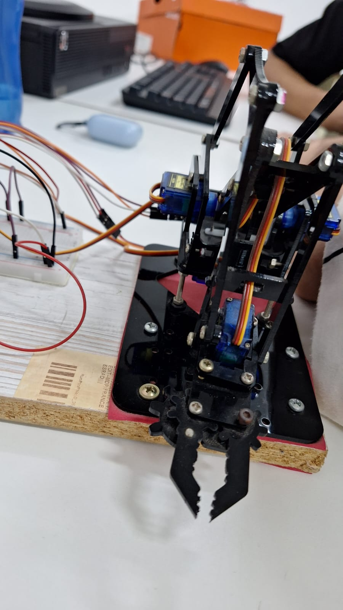
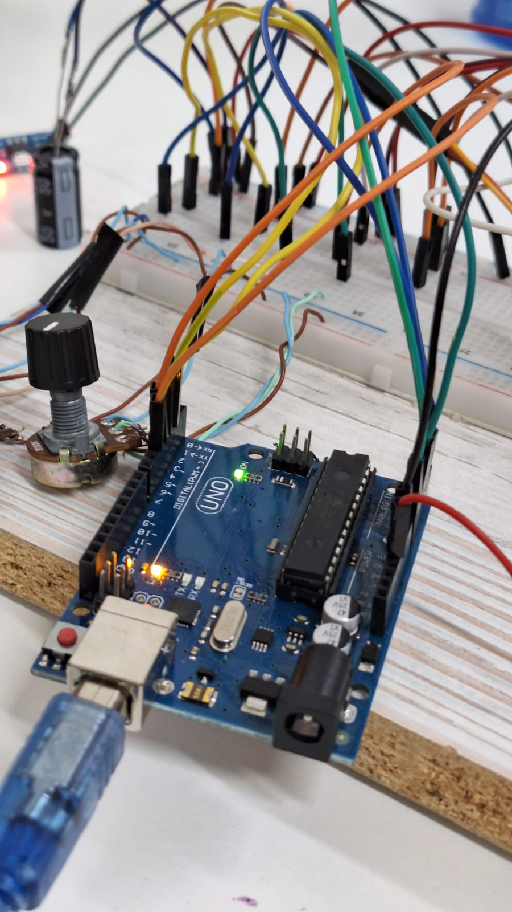
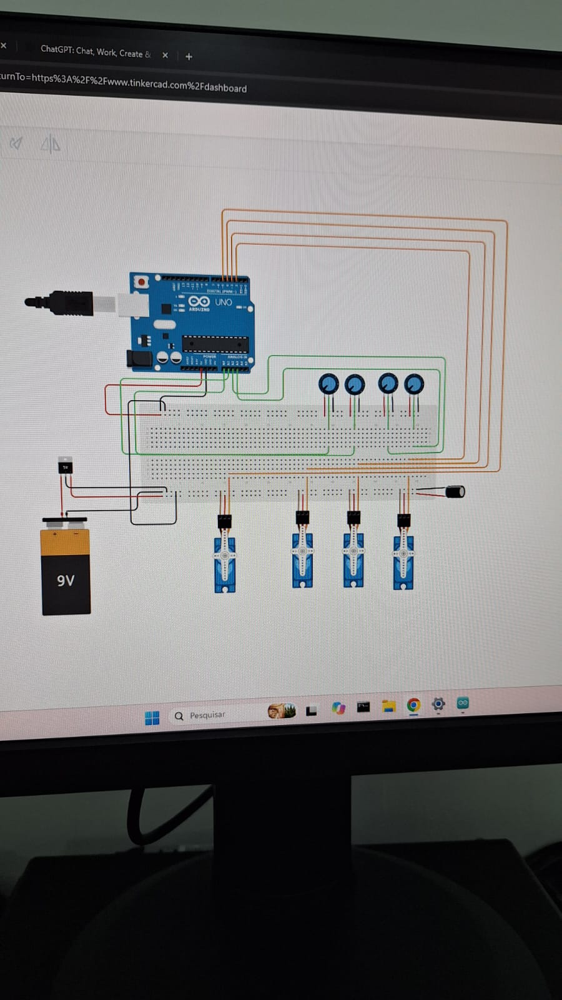

# 🦾 Braço Robótico IoT — Site Explicativo para a Feira Tecnológica

Aplicação web em **PHP + MySQL** que acompanha o nosso dispositivo IoT da Feira Tecnológica: um **braço robótico com 4 servomotores controlado por Arduino**. O site **explica como o braço funciona**, apresenta o **catálogo de componentes**, **cadastra os visitantes** do estande e registra as **dúvidas** que eles fazem (com a resposta da equipe).

> O site é informativo: ele **não controla** o braço.

> **Equipe:** _(preencher: nomes dos integrantes)_ · **Turma/Curso:** _(preencher)_ · **Vídeo de apresentação:** _(colar o link do YouTube)_

---

## 1. O dispositivo IoT

| Braço montado | Arduino + protoboard | Esquema (Tinkercad) |
|---|---|---|
|  |  |  |

Arduino Uno · 4 servomotores (base, ombro, cotovelo, garra) · 4 potenciômetros · protoboard · bateria 9 V com capacitor · estrutura em acrílico sobre base de madeira.

## 2. O que o site faz

| Página | Função | CRUD |
|---|---|---|
| **Como funciona** | Explica o caminho potenciômetro → Arduino → servo e as 4 articulações | conteúdo fixo |
| **Componentes** | Catálogo das peças do braço, agrupadas por categoria | ✅ Criar · Listar · Editar · Excluir |
| **Visitantes** | Cadastro de quem visita o estande | ✅ Criar · Listar · Editar · Excluir |
| **Dúvidas** | Perguntas dos visitantes (sobre um componente ou gerais) e respostas da equipe | ✅ Criar · Listar · Editar · Excluir |

Há também uma **API REST em JSON** do catálogo (`public/api/componentes.php`).

## 3. Arquitetura baseada em serviços

```
Navegador ──► Páginas (public/*.php) ──► Serviços (src/Services/*) ──► Banco MySQL (PDO)
                 apresentação              regras de negócio + SQL          persistência
Cliente HTTP ──► API REST (public/api/componentes.php) ──► ComponenteService
```

```
braco-robotico-feira/
├── config/config.php              # dados de conexão
├── database/schema.sql, seed.sql  # modelo físico comentado + dados de exemplo
├── docs/                          # modelo lógico, roteiro do vídeo, fotos e prints
├── src/
│   ├── Database.php               # conexão PDO (Singleton)
│   ├── helpers.php                # escape HTML, CSRF, layout
│   └── Services/                  # ComponenteService, VisitanteService, DuvidaService
└── public/                        # única pasta exposta ao servidor web
    ├── index.php, como-funciona.php, componentes.php, visitantes.php, duvidas.php
    └── api/componentes.php        # API REST JSON
```

**Por que “serviços”?** Cada entidade tem uma classe de serviço que concentra **validação, regra de negócio e SQL**. As páginas só recebem o formulário e chamam o serviço — nenhum SQL aparece nas páginas, e a mesma classe atende o site **e** a API.

## 4. Banco de dados

Modelo lógico completo (diagrama ER, relacionamentos e normalização) em [`docs/modelo-logico.md`](docs/modelo-logico.md). Script comentado: [`database/schema.sql`](database/schema.sql).

```
categorias  (id PK, nome UNIQUE)
componentes (id PK, categoria_id FK, nome UNIQUE, descricao, quantidade, criado_em, atualizado_em)
visitantes  (id PK, nome, email UNIQUE, instituicao, criado_em)
duvidas     (id PK, visitante_id FK, componente_id FK opcional, pergunta, resposta, criado_em)
```

| Relação | Ao excluir |
|---|---|
| visitante → dúvidas | `CASCADE`: as dúvidas dele são apagadas |
| componente → dúvidas | `SET NULL`: a dúvida permanece e vira “geral” |
| categoria → componentes | `RESTRICT`: categoria em uso não pode ser apagada |

## 5. Rotas do CRUD

| Operação | Página | Como acontece |
|---|---|---|
| **Create** | `componentes.php?acao=novo` (idem visitantes/dúvidas) | `POST acao=salvar` com `id=0` |
| **Read** | `componentes.php` (lista) · `?acao=editar&id=N` (um registro) | `GET` |
| **Update** | `componentes.php?acao=editar&id=N` | `POST acao=salvar` com `id=N` |
| **Delete** | botão *Excluir* | `POST acao=excluir` |

**API REST de componentes**

| Método | Endpoint | Resposta |
|---|---|---|
| GET | `/api/componentes.php` | 200 lista |
| GET | `/api/componentes.php?id=1` | 200 componente · 404 |
| POST | `/api/componentes.php` (JSON) | 201 criado · 422 inválido |
| PUT | `/api/componentes.php?id=1` (JSON) | 200 · 404 · 422 |
| DELETE | `/api/componentes.php?id=1` | 204 · 404 |

## 6. Segurança aplicada

- **PDO com prepared statements** → protege contra SQL Injection
- **`htmlspecialchars` em toda saída** (`e()`) → protege contra XSS
- **Token CSRF** em todos os formulários que alteram dados
- **Validação no servidor** (e-mail, tamanhos, quantidade, existência de categoria/visitante/componente) + `CHECK`/`FOREIGN KEY` no banco
- Apenas a pasta `public/` precisa ficar acessível ao servidor web

## 7. Como executar

**Requisitos:** PHP 8.1+ com extensão `pdo_mysql` e MySQL/MariaDB (o XAMPP já traz tudo).

```bash
# 1) Baixe o projeto
git clone <URL-DO-REPOSITORIO>
cd braco-robotico-feira

# 2) Crie o banco e (opcional) os dados de exemplo
mysql -u root -p < database/schema.sql
mysql -u root -p --default-character-set=utf8mb4 braco_robotico < database/seed.sql

# 3) Ajuste usuário/senha em config/config.php (padrão: root, sem senha)

# 4) Suba o servidor embutido do PHP
cd public
php -S localhost:8000
```

Acesse **http://localhost:8000**.
No XAMPP: copie a pasta para `htdocs/` e abra `http://localhost/braco-robotico-feira/public/`.

## 8. Prints do sistema

> 📸 **Trocar pelos prints reais** (salvar em `docs/img/` com estes nomes).

| Início | Como funciona |
|---|---|
|  |  |

| Componentes | Visitantes | Dúvidas |
|---|---|---|
|  |  |  |

## 9. Tecnologias

PHP 8 · PDO · MySQL/MariaDB · HTML5/CSS3 · Arduino (Servo) no dispositivo · Git/GitHub
