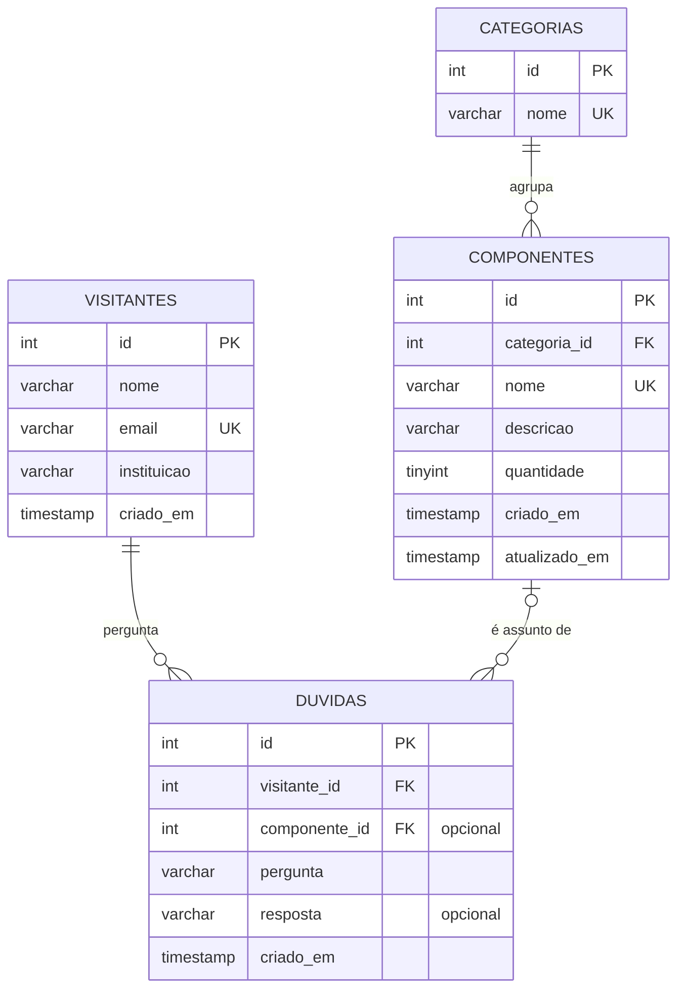

# Modelo lógico do banco `braco_robotico`

## Diagrama entidade-relacionamento



## Esquema relacional

```
categorias   (id PK, nome UNIQUE)
componentes  (id PK, categoria_id FK→categorias.id, nome UNIQUE, descricao, quantidade, criado_em, atualizado_em)
visitantes   (id PK, nome, email UNIQUE, instituicao, criado_em)
duvidas      (id PK, visitante_id FK→visitantes.id, componente_id FK→componentes.id NULL, pergunta, resposta NULL, criado_em)
```

## Relacionamentos

| Relação | Cardinalidade | Comportamento ao excluir |
|---|---|---|
| categorias → componentes | 1:N | `RESTRICT` — categoria em uso não pode ser apagada |
| visitantes → duvidas | 1:N | `CASCADE` — apagar o visitante apaga as dúvidas dele |
| componentes → duvidas | 1:N (opcional) | `SET NULL` — a dúvida permanece e vira "geral" |

## Restrições

| Regra | Onde está |
|---|---|
| Um visitante por e-mail | `UNIQUE (email)` em `visitantes` |
| Nome de componente único | `UNIQUE (nome)` em `componentes` |
| Quantidade de 1 a 99 | `CHECK` em `componentes` + validação em `ComponenteService` |
| Pergunta obrigatória (5 a 500 caracteres) | `NOT NULL` + validação em `DuvidaService` |

## Normalização

- **1FN:** todos os campos são atômicos.
- **2FN / 3FN:** o nome da categoria fica só em `categorias` (não se repete em cada componente) e os nomes de visitante/componente em `duvidas` vêm de `JOIN`, sem duplicar dados.
